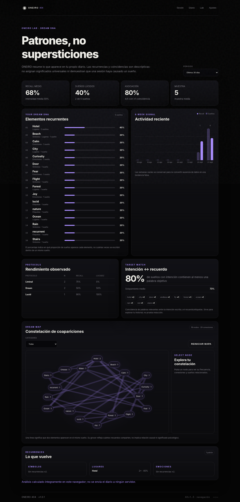
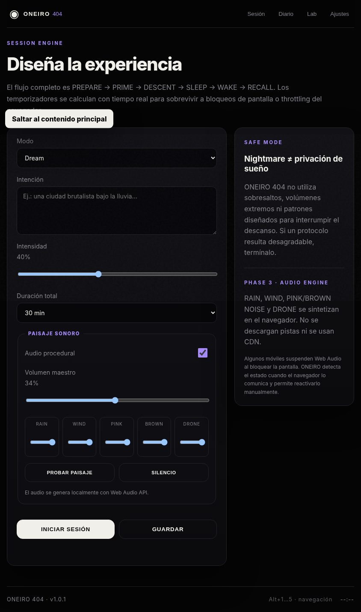

<div align="center">
  

# ONEIRO 404

**Dream induction system · Dream Journal · Local-first PWA**


</div>

ONEIRO 404 es un laboratorio personal de sueños construido en HTML, CSS y JavaScript puro. Funciona sin backend, frameworks ni dependencias externas de ejecución y guarda sus datos en el navegador.

## Estado

**v1.0.1 FINAL-GITHUB**. La auditoría funcional de esta release cubre 20 scripts de prueba, incluidos flujos de navegador real, IndexedDB, Web Crypto, Service Worker, offline, responsive, accesibilidad estática y recuperación ante fallos controlados. Los límites y la evidencia están documentados en `QA_REPORT.md` y `QA_EVIDENCE.json`.

La aplicación sigue siendo una herramienta de registro e incubación temática: no garantiza sueños concretos, lucidez ni resultados fisiológicos.

## Vista previa

### ONEIRO Lab / Dream DNA



### Session Engine / responsive



> Las capturas proceden de las pruebas automatizadas de interfaz incluidas en esta release.

## Funciones

- Protocolos **Dream, Lucid, Nightmare, Liminal, Adventure, Memory y Custom**.
- Motor de sesión **PREPARE → PRIME → DESCENT → SLEEP → WAKE → RECALL**.
- Audio procedural local mediante Web Audio API.
- Dream Journal con IndexedDB: alta, edición, borrado, búsqueda, filtros y migración.
- Dream DNA, Analytics y Dream Map calculados localmente.
- Siete skins: VOID, ONEIRIC, LIMINAL, SOMA, TERMINAL, NOCTURNE y DREAMCORE.
- PIN local opcional, bloqueo manual/automático y preferencias de privacidad.
- Backups JSON con SHA-256 y backups cifrados AES-256-GCM/PBKDF2-SHA-256.
- Restauración Combinar/Reemplazar con snapshot previo y rollback ante fallos detectados.
- PWA instalable, caché offline y solicitud de persistencia cuando el navegador la permite.
- Atajos de teclado, foco, contraste alto y texto grande.

## Ejecutar en local

Desde la carpeta que contiene `index.html`:

```bash
python -m http.server 8080
```

Abre `http://localhost:8080/`.

> Usa HTTP local o HTTPS. `file://` no es el entorno soportado para Service Worker/PWA.

## Publicar en GitHub Pages

El repositorio incluye `.github/workflows/qa.yml`.

1. Crea un repositorio y sube **el contenido de esta carpeta** a la raíz.
2. Usa `main` como rama principal.
3. En **Settings → Pages**, selecciona **GitHub Actions** como fuente.
4. Haz push a `main`.
5. GitHub Actions ejecutará primero QA. Solo si pasa, generará el artefacto estático y desplegará Pages.

El artefacto publicado contiene únicamente `index.html`, `manifest.webmanifest`, `sw.js`, `css/`, `js/` y `assets/`.

Las rutas de la app son relativas y la navegación utiliza hashes (`#session`, `#journal`, etc.), por lo que funciona correctamente dentro de una subcarpeta de GitHub Pages y no necesita redirecciones SPA.

## QA reproducible

Requisitos de desarrollo: Node.js 24+, Python 3.12+ y Chromium de Playwright.

```bash
python -m pip install -r tests/requirements.txt
python -m playwright install chromium
python tests/run-tests.py
```

`real-browser-e2e.py` prueba la aplicación servida bajo una subruta equivalente a GitHub Pages. `storage-browser-faults.py` inyecta fallos controlados de almacenamiento. Los tests `*-ui-smoke.py` complementan esas integraciones, pero no sustituyen la evidencia de navegador real.

## PWA y caché

La caché de producción de esta versión es:

```text
oneiro-404-v1.0.1-final
```

Cuando cambies un recurso precacheado, cambia también el identificador `CACHE` de `sw.js`. Esto evita que una instalación anterior conserve recursos incompatibles.

## Privacidad y seguridad

- El PIN bloquea la interfaz, pero **no cifra IndexedDB**.
- Un backup JSON normal y un snapshot de recuperación son legibles.
- El backup cifrado requiere una contraseña independiente del PIN y no ofrece recuperación de contraseña.
- SHA-256 comprueba integridad del contenido; no autentica al autor del backup.
- La persistencia depende del navegador y el usuario puede perder datos si borra el almacenamiento local.
- Durante restauraciones importantes, usa una sola pestaña y conserva backups externos.

Consulta `SECURITY.md` para el modelo de seguridad y el canal de reporte.

## Limitaciones verificadas

- Web Audio puede suspenderse cuando el dispositivo bloquea la pantalla.
- La instalación PWA depende de HTTPS y de las políticas del navegador/SO.
- Responsive se ha comprobado en viewports automatizados, no en todos los dispositivos físicos.
- Las comprobaciones de accesibilidad no equivalen a una certificación WCAG completa.
- localStorage e IndexedDB no forman una única transacción entre pestañas.

## Estructura

```text
ONEIRO-404/
├── index.html
├── manifest.webmanifest
├── sw.js
├── assets/icons/
├── css/
├── js/
├── tests/
├── docs/screenshots/
├── .github/workflows/qa.yml
├── README.md
├── CHANGELOG.md
├── RELEASE_NOTES.md
├── QA_REPORT.md
├── SECURITY.md
├── CONTRIBUTING.md
└── LICENSE
```

## Licencia

MIT © 2026 I. Roig. Consulta `LICENSE`.
